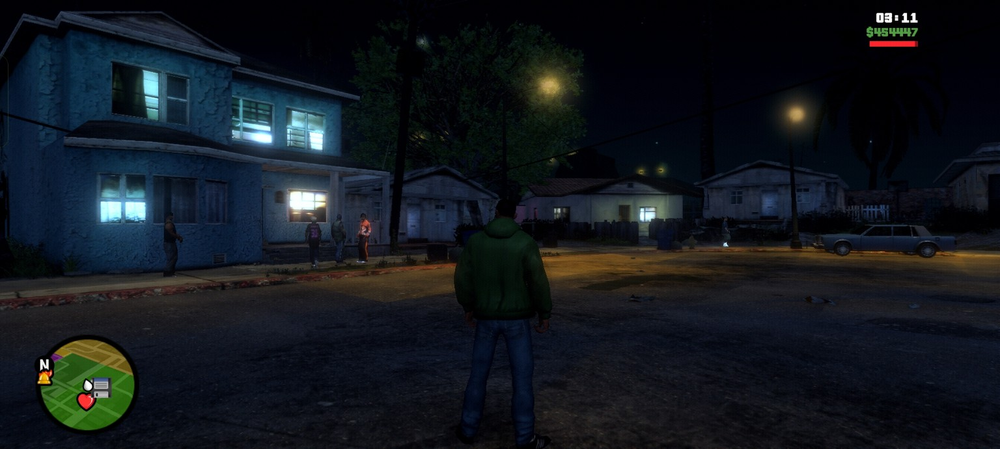
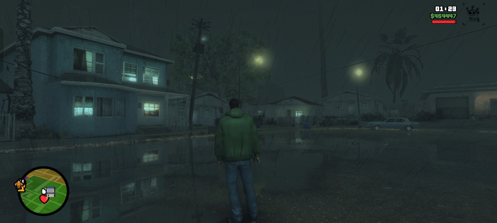
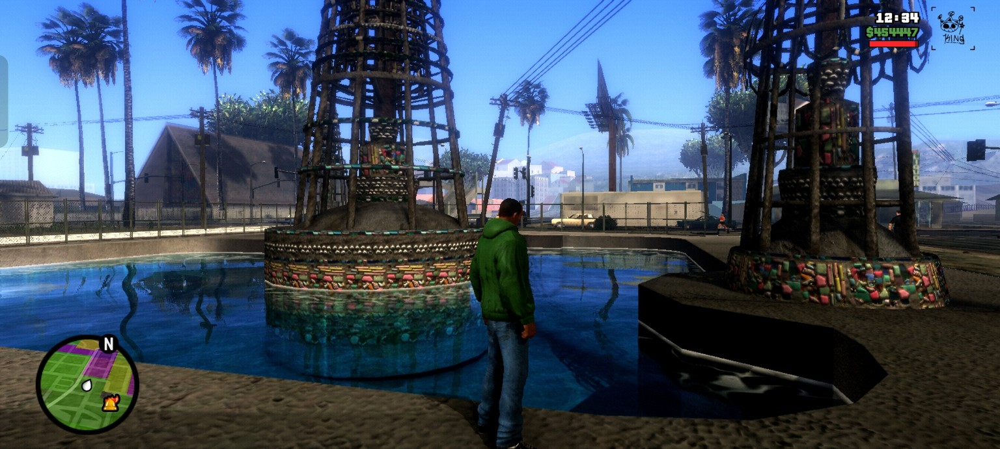
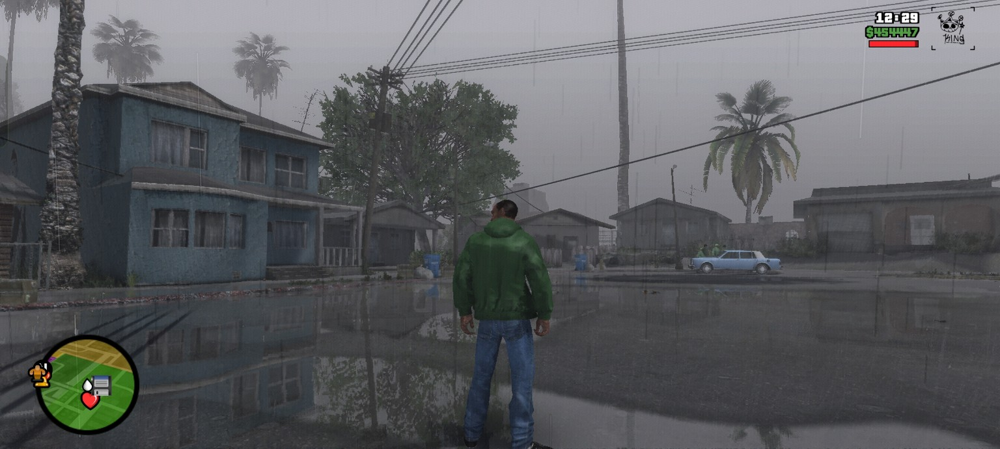
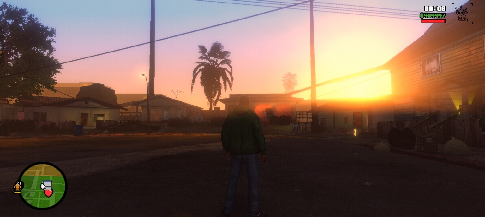
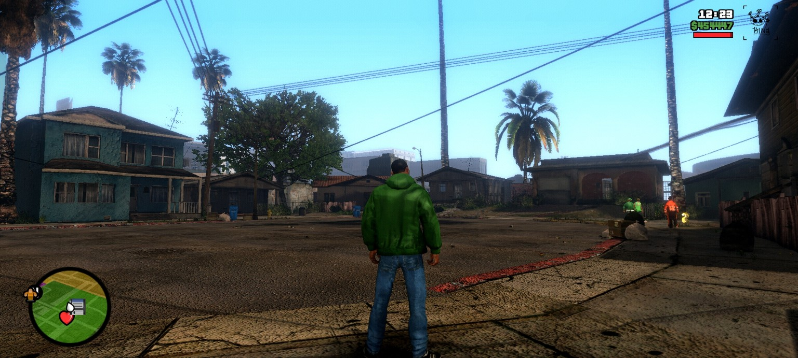
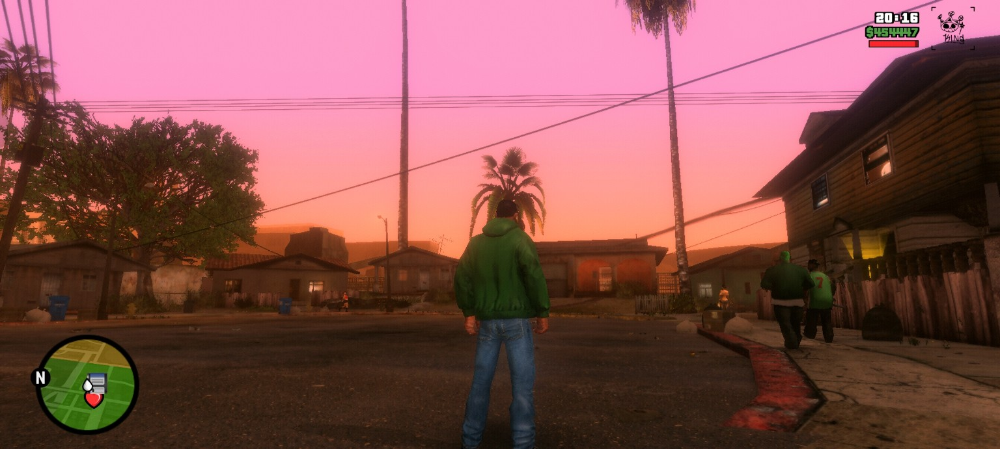
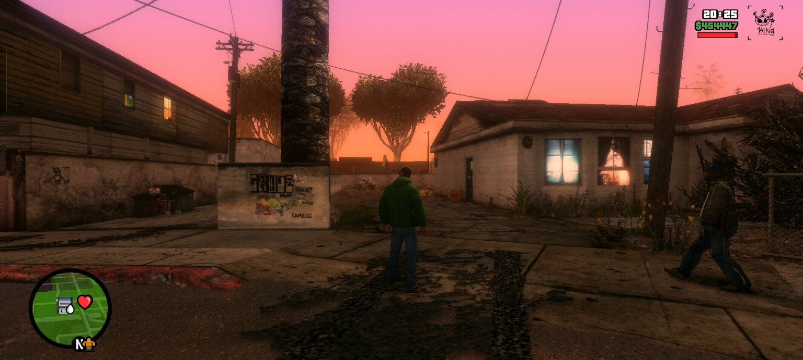

# 🌆 GTA San Andreas — SDGE Reborn 2.0 Inspired Graphics Mod | Timecyc, Colorcycle & ZyzzGFX

<p align="center">
  A custom Android graphics configuration inspired by ENB SDGE Reborn 2.0 for GTA San Andreas PC.
  <br><br>
  <strong>Custom Timecyc · Colorcycle 24H · ZyzzGFX Shaders</strong>
</p>

---

## 📖 Overview

This project is a custom graphics modification for **GTA San Andreas Android**, inspired by the visual style and atmosphere of **ENB SDGE Reborn 2.0** from the PC version.

Unlike the original GTA SA graphics system, this setup does not use the standard Timecyc and Colorcycle files. Instead, it utilizes an external plugin called **`libTimecyc24_64.so`**, developed by **Killman aka RussJJ**, to handle the custom 24-hour Timecyc and Colorcycle system.

Combined with the **ZyzzGFX Shader Plugin**, this configuration introduces customized environmental lighting, color grading, weather atmosphere, and shader adjustments.

This repository provides the configuration files edited and prepared by ZaxxETC. The original ZyzzGFX plugin is NOT included.

## ✨ Features

- **Custom Timecyc 24H** — Modified environmental lighting and atmosphere throughout the day.
- **Custom Colorcycle 24H** — Adjusted environmental colors and visual tones.
- **ZyzzGFX Shaders** — Custom shader configuration for the ZyzzGFX plugin.
- **Cinematic Lighting** — Inspired by ENB SDGE Reborn 2.0 on PC.
- **Weather Atmosphere** — Customized visual appearance for different weather conditions.
- **Rain Reflections** — Visible wet-surface reflections during rainy conditions.
- **Sunrise & Sunset** — Warm orange, pink, and golden color transitions.
- **Night Lighting** — Dark blue atmosphere with enhanced environmental light contrast.

## 🎨 Visual Showcase

The following screenshots demonstrate the visual appearance of this configuration across different times and weather conditions.

### Night & Lighting

<p align="center">
  
  <br>
  <em>Night lighting and environmental atmosphere</em>
</p>

<p align="center">
  
  <br>
  <em>Rainy night with wet-surface reflections</em>
</p>

### Daytime & Weather

<p align="center">
  
  <br>
  <em>Daytime lighting and environmental colors</em>
</p>

<p align="center">
  
  <br>
  <em>Rainy weather with atmospheric lighting and road reflections</em>
</p>

### Sunrise & Sunset

<p align="center">
  
  <br>
  <em>Morning lighting and sunrise atmosphere</em>
</p>

<p align="center">
  
  <br>
  <em>Clear daytime environment</em>
</p>

<p align="center">
  
  <br>
  <em>Warm sunset color grading</em>
</p>

<p align="center">
  
  <br>
  <em>Sunset atmosphere across the neighborhood</em>
</p>

## ⚙️ Graphics Components

### 1. Timecyc & Colorcycle 24H

**Plugin:** `libTimecyc24_64.so`  
**Author:** Killman aka RussJJ

This plugin replaces the regular Timecyc and Colorcycle system included in the original GTA SA game.

It serves as the foundation for the custom 24-hour lighting and color configuration, allowing the game to use the modified environmental settings.

### 2. ZyzzGFX Shader Plugin

**Author:** Zyzz reincarnate

ZyzzGFX handles the shader-related graphics configuration used in this setup.

The provided configuration has been edited to complement the custom Timecyc and Colorcycle, creating a more consistent visual atmosphere.

**Note:** The ZyzzGFX plugin itself is not included. Only its configuration files are distributed in this repository.

## 📱 Compatibility

| Component | Requirement |
|:--|:--|
| Game | GTA San Andreas Android |
| AML | v2.10 |
| Architecture | 64-bit (ARM64) |
| Timecyc Plugin | `libTimecyc24_64.so` |
| Graphics Plugin | ZyzzGFX |
| Game Version | Compatible GTA SA 64-bit build |

**Important:** This configuration is specifically designed for GTA SA AML v2.10 64-bit. Compatibility with other versions is not guaranteed.

## 📁 Included Files

| Component | Description |
|:--|:--|
| Timecyc | Custom 24-hour lighting configuration |
| Colorcycle | Custom environmental color configuration |
| ZyzzGFX | Modified shader configuration |

This repository only distributes configuration files, not the original external plugins.

## 📲 Installation Guide

### Requirements

Before installing, make sure you have:

- GTA San Andreas Android.
- AML v2.10 64-bit.
- `libTimecyc24_64.so` plugin.
- ZyzzGFX Shader Plugin.
- Configuration files from this repository.

### 1. Install Required Plugins

The required plugins must be installed separately.

This repository does not include the ZyzzGFX plugin or the original `libTimecyc24_64.so` plugin.

You can find the plugins and their installation tutorials on YouTube by searching:

- `ZyzzGFX GTA SA Android`
- `libTimecyc24_64.so GTA SA Android`

Make sure both plugins are compatible with AML v2.10 64-bit.

### 2. Download Configuration

1. Download or clone this repository.
2. Extract the downloaded archive.
3. Locate the `com.rockstargames.gtasa` folder.

### 3. Copy Configuration Files

Copy the entire **`com.rockstargames.gtasa`** folder into the following directory:

```text
android_unprotected/
└── data/
    └── com.rockstargames.gtasa/
        └── [Configuration Files]
```

**Installation steps:**

1. Open your GTA SA storage directory.
2. Locate the `android_unprotected` folder.
3. Open its `data` directory.
4. Copy the provided `com.rockstargames.gtasa` folder into it.
5. If prompted, merge the folders and replace the existing configuration files.

**Important:**
- Make sure the destination is `android_unprotected/data/`.
- Do not accidentally create a duplicated nested folder.
- Back up your original files before replacing them.
- Keep the original folder structure intact.

### 4. Launch the Game

After completing the installation:

1. Verify that both required plugins are installed.
2. Check the configuration directory.
3. Launch GTA San Andreas.
4. Enjoy the modified graphics configuration.

## ⚠️ Important Notes

- The original GTA SA Timecyc and Colorcycle system is not used by this setup.
- `libTimecyc24_64.so` is required for the custom Timecyc and Colorcycle.
- ZyzzGFX Shader Plugin must be installed separately.
- This repository only provides configuration files.
- Intended for AML v2.10 64-bit.
- Visual results may vary depending on device hardware, GPU, and game build.
- Always keep a backup of your original files.

## 🙏 Credits & Special Thanks

Special thanks to the original developers and contributors:

| Contributor | Contribution |
|:--|:--|
| **Killman aka RussJJ** | Author of `libTimecyc24_64.so` |
| **Zyzz reincarnate** | Author of ZyzzGFX Shader Plugin |
| **ZaxxETC** | Editing and configuration of Timecyc, Colorcycle 24H, and ZyzzGFX |

All original plugins and their respective work belong to their authors.

## 📜 Disclaimer

This is an unofficial community-made graphics configuration for GTA San Andreas Android.

This project is not affiliated with Rockstar Games or the original developers of the mentioned plugins.

All original plugins, assets, and trademarks belong to their respective owners.

---

<p align="center">
  <strong>Reimagining San Andreas, one configuration at a time.</strong>
  <br>
  <sub>Graphics configuration by ZaxxETC</sub>
</p>
<p align="center">
  
  
  
  
  
</p>
